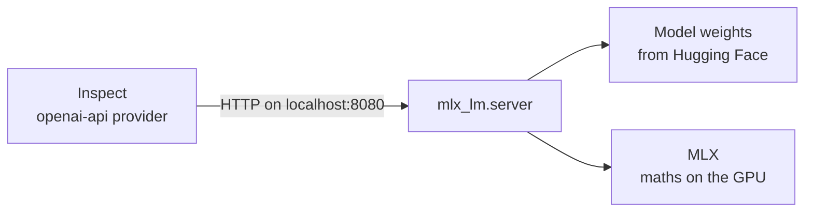

# MLX for local eval models

What Apple's MLX is, which parts of its documentation matter for running local models in Inspect evals, and the ML terms the docs assume you already know. Run [mlx_tour.py](mlx_tour.py) alongside this; each section below points to the part of the script that demonstrates it.

Tested on 6 October 2026 with MLX 0.32.3 and mlx-lm 0.32.0 on an M5 Pro with 48 GB.

## The short version

- **MLX** is Apple's library for doing ML maths on the Mac's GPU. Think "NumPy, but fast on Apple silicon". The [MLX guide](https://ml-explore.github.io/mlx/build/html/usage/quick_start.html) documents this layer.
- **mlx-lm** is a separate package built on MLX. It downloads language models, runs them, and serves them over an OpenAI-style API. **This is the part you will actually use.**
- You will rarely write MLX code yourself. You need enough of it to understand memory, speed and model names, which is what this guide covers.



## Using it with Inspect

These steps were run end to end. Inspect's script 01 and script 02 (with real tool calls) both worked against a local model.

1. Start the server in its own terminal. The first run downloads the model.

   ```sh
   cd ResearchShop && source .venv/bin/activate
   mlx_lm.server --model mlx-community/Qwen3-8B-4bit --port 8080
   ```

2. Add these lines to `inspect_sandbox/.env`:

   ```sh
   MLX_BASE_URL=http://localhost:8080/v1
   MLX_API_KEY=local    # any value; Inspect refuses to start without one
   ```

3. Run an eval. The model name is `openai-api/mlx/` followed by the name you gave the server:

   ```sh
   cd inspect_sandbox
   inspect eval scripts/02_tool_use.py -T scripted=false \
       --model openai-api/mlx/mlx-community/Qwen3-8B-4bit --max-connections 1
   ```

Things to know:

- **`--max-connections 1`:** the server is built for one user. Inspect sends several requests at once by default, and they just queue.
- **Tool calling works natively** with Qwen3 models. If a model's tool calls come back as plain text instead, add `-M emulate_tools=true` so Inspect handles the tool format itself.
- **The server listens on localhost only** by default. Don't pass `--host 0.0.0.0`: it has no authentication.
- **A local model doesn't make tool commands safe.** Script 04 still needs `-T sandbox=docker` for any real model.

### Which model to use

| Model | Download | Good for |
| --- | --- | --- |
| `mlx-community/Qwen3-0.6B-4bit` | 0.35 GB | Testing that the plumbing works. Fast, but often confidently wrong. |
| `mlx-community/Qwen3-8B-4bit` | 4.6 GB | Your everyday local model. Handles tool calls well enough for learning. |
| `mlx-community/Qwen3-30B-A3B-4bit` | 17 GB | Closer to hosted-model quality, and still fast (see "mixture of experts" below). |

Newer models appear constantly. Browse [huggingface.co/mlx-community](https://huggingface.co/mlx-community) and use part 5 of the tour to check whether one fits. Delete downloaded models from `~/.cache/huggingface/hub` when you're done with them.

## The MLX guide, page by page

What each usage page is about and whether you need it.

| Page | Verdict | Why |
| --- | --- | --- |
| Quick Start | **Read** | Arrays, dtypes and lazy evaluation in two minutes. Skip its `grad` examples. |
| Lazy Evaluation | **Read** | Explains timing surprises. Tour part 2. |
| Unified Memory | **Read** | Why a Mac can run big models. Tour part 3. |
| Numerical Precision | Skim | One setting (`MLX_ENABLE_TF32=0`) for when exact repeatability matters. |
| Saving and Loading Arrays | Skim | Tells you what `.safetensors` and `.gguf` model files are. |
| Conversion to NumPy | Skim | Only needed if you post-process model outputs as arrays. |
| Environment Variables | Skim | Reference only. Nothing you need to set. |
| Writing a Fast KV Cache | Skip the code, learn the idea | The KV cache is why long conversations slow down and use more memory. mlx-lm already handles it. |
| Using Streams | Skip | Choosing CPU or GPU per operation. Tour part 3 shows the one idea worth knowing. |
| Indexing Arrays | Skip | NumPy-style slicing. Only matters if you write array code. |
| Function Transforms | Skip | `grad` and `vmap` are for **training** models. You run them, you don't train them. |
| Compilation | Skip | A speed optimisation for people writing model code. |
| Exporting Functions | Skip | Running MLX code from C++ or Swift. |
| Distributed Communication | Skip | Splitting one model across several Macs. |

The **API reference** (`mlx.core`, `mlx.nn`, `mlx.optimizers`) is for model builders; you won't need it. The **LLM inference** example builds a Llama model from scratch in about 200 lines. Read it later if you want to know what's inside a language model, but mlx-lm does all of this for you.

## Glossary

Terms the MLX docs and model pages use without explaining. Grouped by topic, roughly in the order you'll meet them.

### The basics

**Array / tensor.** A grid of numbers, any number of dimensions. MLX calls it an array; most ML writing calls it a tensor. Same thing.

**Weights / parameters.** The numbers inside a model, learned during training. "8B" in a model name means 8 billion of them. Running a model is mostly multiplying your input by these weights.

**Inference vs training.** Training is *making* a model by adjusting its weights, which is slow, costly and needs gradients. Inference is *running* a finished model to get outputs. Evals are pure inference. That's why half the MLX guide (gradients, optimisers, `grad`, `vmap`) doesn't concern you.

**Gradient / autodiff.** Maths that tells training which direction to nudge each weight. `mx.grad` computes it automatically. You can safely ignore it.

### Numbers and memory

**dtype.** The number format each element is stored in. It sets bytes per number, and so model size. Tour part 1.

| dtype | Bytes | Notes |
| --- | --- | --- |
| float32 | 4 | Full precision. Too big for whole models. |
| float16 | 2 | Precise, but overflows above about 65,000. |
| bfloat16 | 2 | Less precise, same range as float32. Most LLMs ship in this. |

**Quantization.** Storing weights in 4 or 8 bits instead of 16, with a scale and offset per small group so they can be approximately restored. A model named `...-4bit` is quantized. It is about 3.5 times smaller, with a small quality loss. Tour part 4.

**Unified memory.** On Apple silicon the CPU and GPU share one memory pool, so no copying between them, and the GPU can use most of your RAM. On a PC the GPU only has its own, much smaller, memory. Your 48 GB Mac lets the GPU use about 37 GB. Tour part 3.

**Lazy evaluation.** MLX records what you asked for and only computes it when the result is needed (printing it, `.item()`, `mx.eval()`). The practical effect: time MLX code only after forcing evaluation, or you're timing nothing. Tour part 2.

**Metal.** Apple's GPU programming interface. MLX uses it under the hood. When you see "Metal" in errors or docs, read "the GPU".

### Language models

**Token.** The unit a model reads and writes: a chunk of text, often part of a word. "Honeytokens" becomes `H` + `oney` + `tokens`. Context limits, speed and API prices are all counted in tokens. Tour part 6.

**Tokenizer.** The component that converts text to token ids and back. Every model comes with its own.

**Context window.** The most tokens a model can consider at once (prompt plus reply). Agents hit this on long tasks, because every tool call and result is added to the conversation.

**Chat template.** Chat models were trained on conversations wrapped in special marker tokens like `<|im_start|>user`. The template turns a list of messages into that exact text. Inspect and the server apply it for you. Tour part 6 prints one.

**Prefill vs decode.** The two phases of generation. Prefill reads the whole prompt in one fast parallel pass. Decode writes the reply one token at a time, which is slower per token. The tour reports both speeds.

**KV cache.** Memory where the model keeps its working state for every token so far, so it doesn't reprocess the whole conversation for each new token. It grows with conversation length, which is why the memory estimates add about 20% for context.

**Temperature / sampling.** How the model picks each next token from its scored options. At temperature 0 it always takes the top choice, so replies repeat exactly. At about 1 it picks at random by score, so replies vary. For evals, use 0 for repeatability, or run several epochs at higher temperatures. Tour part 6 shows both.

**Mixture of experts (MoE).** A model split into many sub-networks ("experts"), where only a few run for each token. `Qwen3-30B-A3B` has 30B parameters in total but only about 3B active per token. It needs memory for 30B but runs at roughly 3B speed.

**Thinking / reasoning models.** Models that write hidden step-by-step reasoning before answering. Qwen3 does this by default (the `<think>` section in its chat template). It improves answers but uses many more tokens.

### Files and sources

**Hugging Face.** The main public site for model downloads. Names like `mlx-community/Qwen3-8B-4bit` are `organisation/model`. `mlx-community` publishes ready-converted MLX versions of popular models.

**safetensors / GGUF.** File formats for model weights. Both hold numbers only, not code, which is why they replaced older Python "pickle" files that could run code when loaded. MLX reads both.

**`trust_remote_code`.** An option on `mlx_lm.load()` and the server that lets a model repo run its own Python code. It is off by default. Leave it off unless you have read that code.

## Next steps

1. Run `python mlx_sandbox/mlx_tour.py`, then `--llm`.
2. Serve `Qwen3-8B-4bit` and run Inspect scripts 01–03 against it with `-T scripted=false`.
3. Compare the logs in `inspect view` with the scripted runs. Real models are messier, and that mess is what your monitors need to handle.
